# Bearing Fault Diagnosis Model Based on KAN and Convolutional Kernels

Update and add code:
\n        \n  
Compare the five bearing fault diagnosis models based on KAN and CKAN (Convolutional Kolmogorov-Arnold Network)
MLP: Two-layer MLP (64 neurons in the first layer, 32 neurons in the second layer)
KAN: Two-layer optimized KANLinear (64 neurons in the first layer, 32 neurons in the second layer)
CNN-1D: Three-layer standard 1D convolutional pooling layer + one linear layer
CNN-1D-KAN: Three-layer standard 1D convolutional pooling layer + one KANLinear
KAN-Conv: Two-layer KANConv + one linear layer
The experimental results of the five models are as follows: (Note! This code is also relatively easy to integrate with our previous models. On this basis, adding some experiments or modules can be directly used for publishing articles!!!)
Relevant learning materials and complete data, five classification codes are as follows:
\n        \n  
Dataset: CWRU West Storage University Bearing Dataset
Environmental framework: Python 3.9, PyTorch 2.0 and above are compatible for execution
Output results: Training loss curve graph, accuracy report on test set, confusion matrix
Usage object: Paper requirements, graduation design requirements
Code guarantee: Code comments are detailed, ready to run without modification.

The latest AI buzzword in the circle is KAN (Kolmogorov-Arnold Network). Shouldn't we be able to diagnose bearing faults based on KAN? The core of writing papers lies in keeping up with the cutting edge and tasting the soup with the big shots! With this hot topic emerging, students who need paper requirements should seize the opportunity!

Preface
This article is based on the CWRU bearing data, first preprocessed to create and load the dataset, and finally optimized KAN models and KAN convolutional models through PyTorch to classify fault data. A detailed introduction to the CWRU bearing data can be found in the following text:
Python-CWRU Bearing Data Interpretation and Classification Processing
1. KAN network introduction
1.1 Three characteristics of KAN networks
Mathematical basis
High accuracy
Interpretable
1.2 Traditional MLP essence
Multilayer Perceptrons (MLPs), also known as fully connected feedforward neural networks, are the foundational building blocks of deep learning models. The importance of MLPs cannot be understated; they serve as the default model for approaching nonlinear functions in machine learning, with their expressive power guaranteed by the universal approximation theorem.
(1) Gradient vanishing: Gradient approaches zero, making it impossible for network weights to update or update very minimally, resulting in no effect over time even after extensive training.
Gradient explosion: The gradients grow exponentially, becoming very large, which then leads to significant updates in network weights, making the network unstable.
(2) Low parameter efficiency:
\tMLP typically uses fully connected layers, which means each neuron in a layer is connected to all neurons in the previous layer, leading to a rapid increase in parameter count, especially for data with high input dimensions; this not only increases computational burden but also increases the risk of overfitting.
(3) Poor interpretability:
Despite the widespread use of MLPs, they have significant drawbacks. For instance, in Transformers, MLPs consume almost all non-embedding parameters and are generally less interpretable compared to attention layers without subsequent analysis tools. Their interpretability is relatively poor, similar to a black-box model, unable to explore how learning occurs.
\t1.3 Comparison between MLP and KAN
\t  
(1) Kolmogorov-Arnold theorem:
\tAny multivariable continuous function can be represented as the combination of some single variable functions!
From a mathematical perspective, the core of any problem lies in fitting a function.
(2) Activation functions that can be learned:
In neural networks, the input-output process of each layer is a linear summation. Therefore, without activation functions, no matter how complex and numerous layers you construct your neural network, its output will always be a linear combination of the input. Pure linear combinations are insufficient to solve more complex problems. However, once activation functions are introduced, we find that common activation functions are nonlinear, enabling neural networks to approximate any other nonlinear function. Unlike MLPs, where activation functions are fixed, KAN activation functions are learnable, allowing for variation!
MLP: Activation function fixed, input is added before activation.
\tKAN: The activation function is learnable, the input is activated first and then added.
(3) Spline Function:
In KAN, each layer of the nonlinear function Ф adopts the same function structure, but it uses different parameters to control its shape. The article selects the spline function from numerical analysis as the nonlinear function, and spline theory is a powerful tool for function approximation.
Spline functions are composed of multiple polynomial segments, each defining between adjacent nodes. These segments are connected at the nodes to ensure the smoothness of the overall function.
\t  
\t  
Spline curves have an advantage of having a clear geometric meaning. Through the truncated angle algorithm (nested linear interpolation), curve segmentation, derivative vector calculation, and curve division can be conveniently performed, not only facilitating various operations but also offering higher precision than polynomial spline curves based on power basis functions.
(4) Comparison between MLP and KAN:
MPL is a fixed nonlinear activation + linear parameter learning, and KAN is the direct learning of the parameterized nonlinear activation function. KAN realizes using fewer nodes, smaller networks to achieve the same effect, even better!
\t1.4 KAN Execution Process
\t  
1.5 Explanability
Run the hellokan.ipynb file in the code to implement the above visualization process.
2. KAN Convolution (CKAN)
\t2.1 CKAN  
Recently, researchers have extended the concept of KAN innovation architecture to convolutional neural networks, changing the classic linear transformation of convolutions into learnable non-linear activation functions within each pixel. They proposed and open-sourced KAN Convolution (CKAN).
\tKan convolutions are very similar to convolutions, but instead of applying dot product between the kernel and corresponding pixels in the image, they apply a learned non-linear activation function to each element and then sum them up. The kernel of Kan convolutions is equivalent to a 4-input and 1-output neuron linear layer of Kan.
\t  
2.2 Parameters in CKAN
Assuming a KxK kernel, for each element of the matrix, there is a ϕ with parameter count: gridsize + 1, where ϕ is defined as:
\t  
This provides more expressiveness for the activation function b, with the number of parameters in a linear layer being gridsize + 2. Therefore, the total number of parameters in KAN convolutions is K^2(gridsize + 2), whereas the number of parameters in standard convolutions is only K^2.
\t3.3 CKAN in Bearing Fault Diagnosis
Through the previous comparative experiments, it is evident that convolutional networks based on KAN outperform traditional convolutional networks in the task of bearing fault classification. However, they require longer training times. Future considerations could involve integrating other modules for further optimization; moreover, the basic KAN layers can completely replace fully connected layers in classification tasks, resulting in significant improvements. Further comparative experiments with other datasets could be conducted. Overall, the implementation of KAN convolution is a promising idea, and its application in bearing fault diagnosis tasks also holds potential, warranting exploration!
3. Data Preprocessing for Bearing Faults
1.1 Import data
Refer to the previous article for preprocessing of fault classification 10, and the Case Western Reserve University bearing data set: Classification 10 dataset.
\ttrain_set, val_set, test_set are all divided into training set, validation set and test set according to the ratio of 7:2:1, and finally save data.
The above figure illustrates the data reading format and preprocessing approach.
1.2 Data preprocessing, dataset preparation
4. Bearing Fault Diagnosis Based on Pytorch-KANConv
\t4.1 Define the KANConv classification network model, set parameters, and train the model
100 epochs, with training and validation accuracy of 98%, the classification effect of the improved KAN convolutional network is significant. The model can fully extract fault features from bearing fault signals, has a fast convergence speed, superior performance, high precision, and noticeable effects! (The downside is that it runs slower than traditional CNN networks).
4.3 Model Evaluation
Accuracy, Precision, Recall, F1 Score
Fault-classification confusion matrix:
Previously excellent content:
Python - Kaiser Permanente University (CWRU) Bearing Data Interpretation and Classification Process
Python Bearing Fault Diagnosis (Part I): Short-Time Fourier Transform STFT
Python Bearing Fault Diagnosis (Part II): Continuous Wavelet Transform CWT
Python Bearing Fault Diagnosis (Part III): Empirical Mode Decomposition EMD
Pytorch-LSTM Bearing Fault One-Dimensional Signal Classification (Part I)
Pytorch-CNN Bearing Fault One-Dimensional Signal Classification (Part II)
Pytorch-Transformer Bearing Fault One-Dimensional Signal Classification (Part III)
Python Bearing Fault Diagnosis (Part IV): Based on EMD-CNN for Fault Classification
Python Bearing Fault Diagnosis (Part V): Based on EMD-LSTM for Fault Classification
Python Bearing Fault Diagnosis (Part VI): Based on EMD-Transformer for Fault Classification
Python Bearing Fault Diagnosis (Part VII): Based on EMD-CNN-LSTM for Fault Classification
Python Bearing Fault Diagnosis (Part VIII): Based on EMD-CNN-GRU Parallel Model for Fault Classification
Bearing Fault Identification Model based on FFT + CNN - BiGRU-Attention for Time and Frequency Feature Attention Fusion
Bearing Fault Identification Model based on FFT + CNN - Transformer for Time and Frequency Feature Fusion
Python bearing fault diagnosis (IX) VM-based fault classification based on VMD+CNN-BiLSTM
Python bearing fault diagnosis (X) VM-based fault classification based on VMD+CNN-Transformer
Python bearing fault diagnosis (11) VM-based fault classification based on VMD+CNN-BiGRU-Attenion
Cross attention fusion of time and frequency domain features with FFT + CNN - BiLSTM-CrossAttention bearing fault recognition model
Cross attention fusion of time and frequency domain features with FFT + CNN-Transformer-CrossAttention bearing fault recognition model
Python bearing fault diagnosis tutorial
Python bearing fault diagnosis (13) Super machine learning recognition model based on fault signal feature extraction
Python bearing fault diagnosis (14) Highly innovative fault recognition model
Python bearing fault diagnosis (15) One-dimensional fault signal recognition model based on CNN-Transformer
Python bearing fault diagnosis (16) Highly innovative fault recognition model (II)
SCI 1st class high innovation bearing fault diagnosis model!
Python bearing fault diagnosis (18) Innovative diagnostic model based on CNN-TCN-Attention
Based on GADF+Swin-CNN-GAM high innovation bearing fault diagnosis model
Attention magic modification | Super bearing fault diagnosis model!
Bearing fault—cross attention innovative model family set
Python bearing fault diagnosis (19) Innovative diagnostic model based on Transformer-BiLSTM
END

## Images

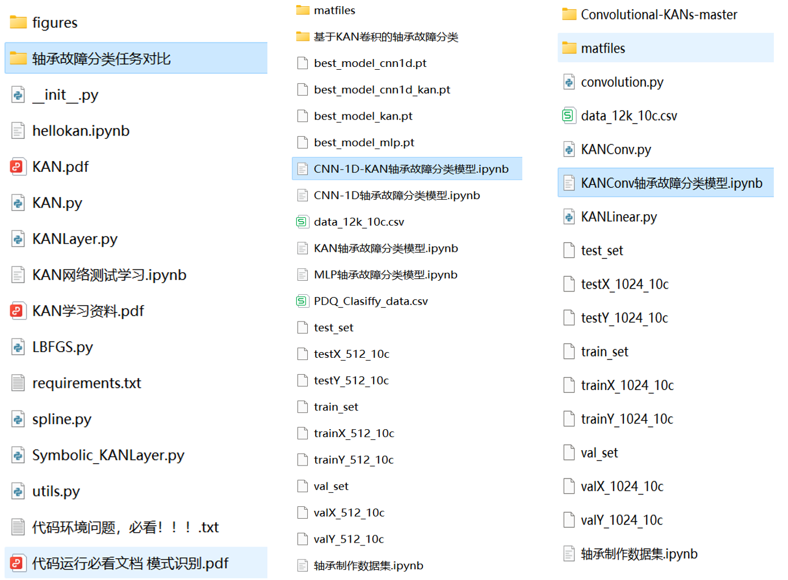
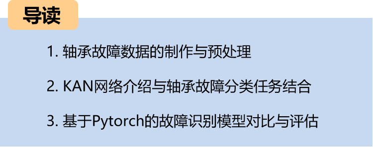
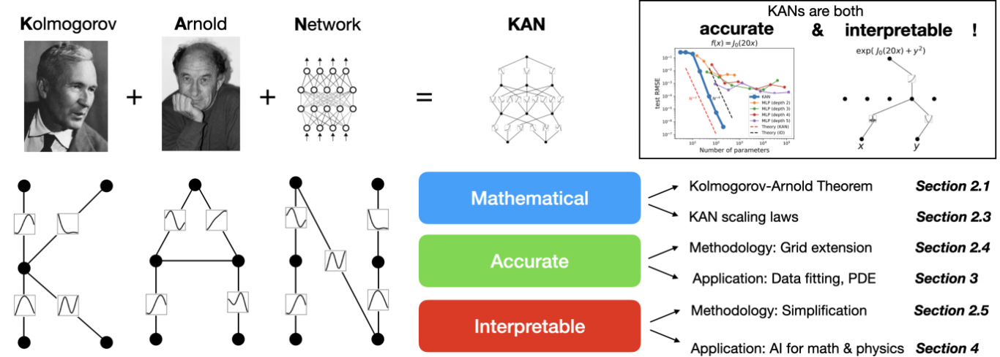
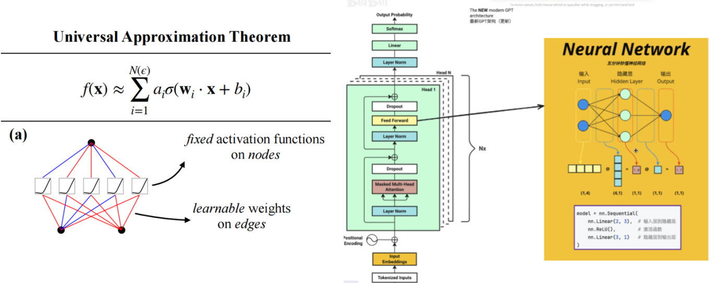
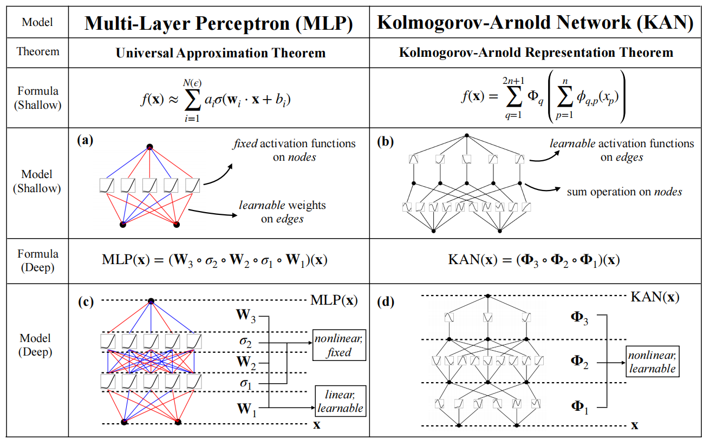
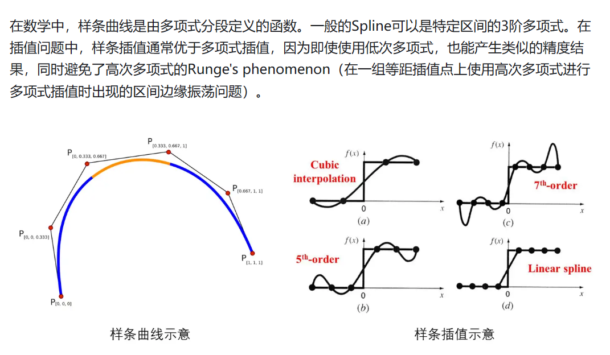
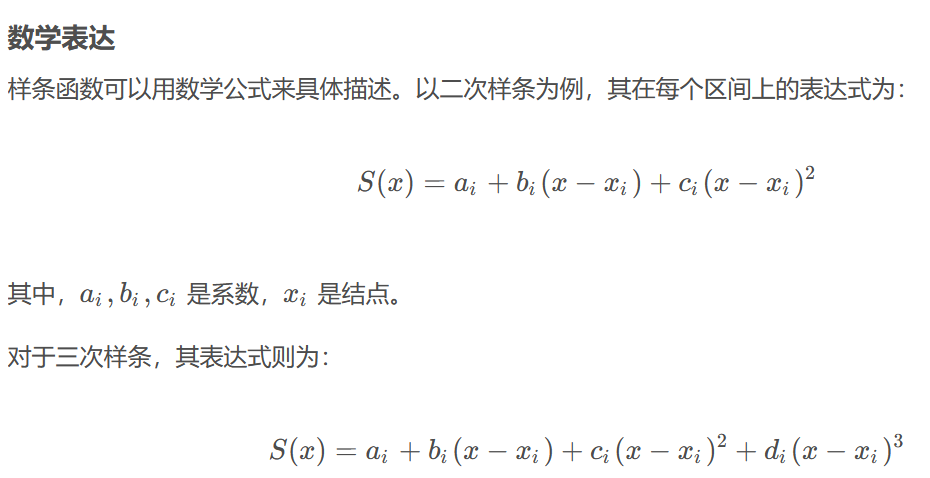
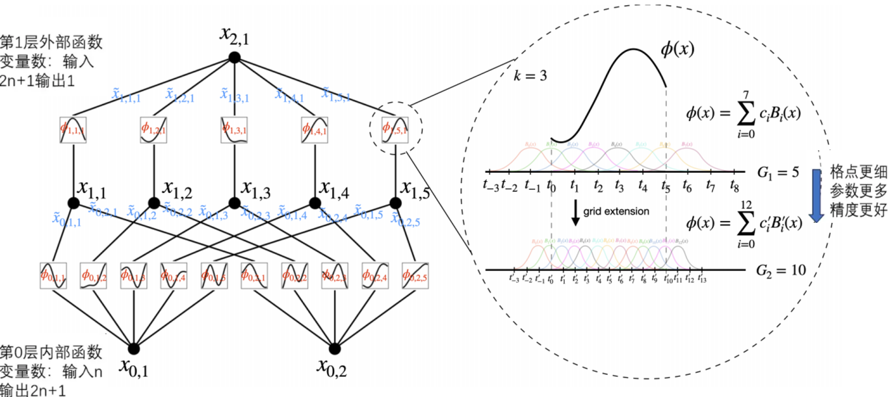
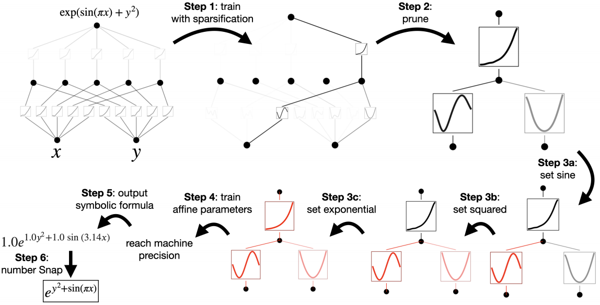
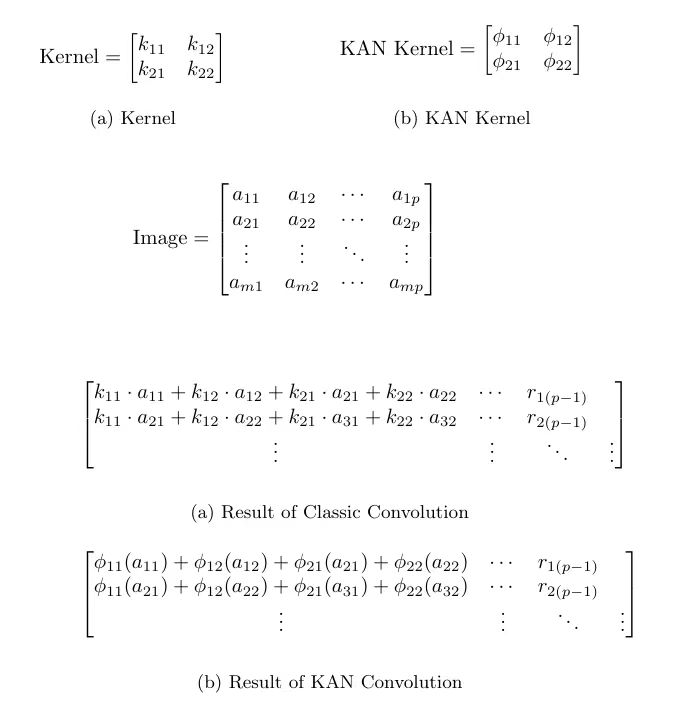
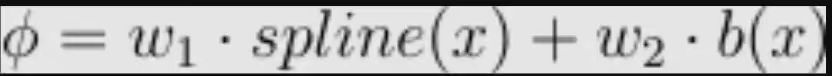

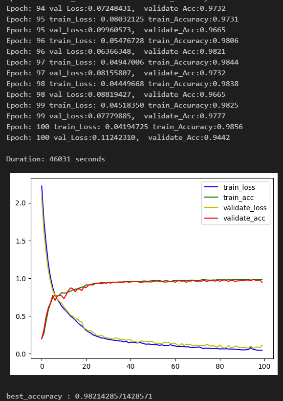
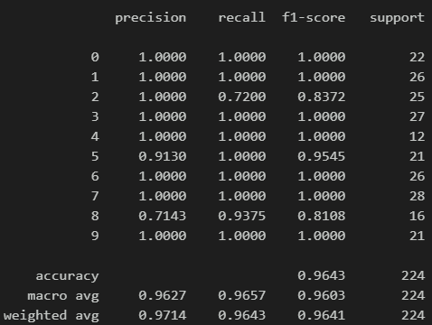
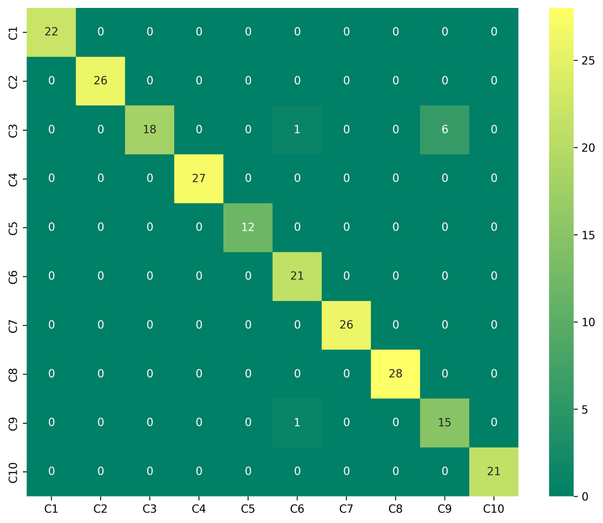
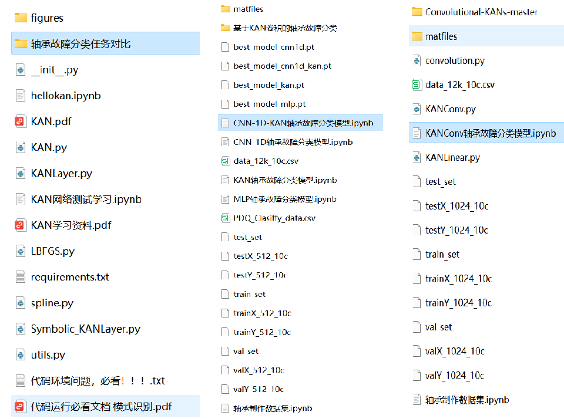

<!-- PAYMENT_BLOCK -->

## Get this dataset

- Payment link (Stripe): [Buy now](https://buy.stripe.com/3cs8yP7sY87d0vu9AB)
- Payment QR code: 

<!-- /PAYMENT_BLOCK -->
